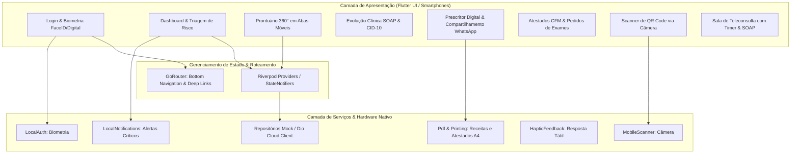

# Plano de Implementação: Aplicativo Mobile "Meu Diário Profissional" em Flutter

## Goal Description

Criar um **aplicativo mobile nativo em Flutter (Dart)**, alocado em uma **pasta separada** (ex: `../meu-diario-profissional-mobile/` ou `./mobile-flutter/`), reproduzindo **100% das funcionalidades clínicas** do "Meu Diário Profissional", com foco em **ergonomia móvel para smartphones (Android e iOS)** e recursos nativos de hardware.

### Diretrizes Centrais
1. **Pasta e Projeto 100% Isolados:** O projeto Flutter terá seu próprio `pubspec.yaml`, dependências nativas e estrutura de compilação sem interferir no projeto web existente.
2. **Stack Tecnológica Flutter 3.44+:** Utilizando Dart 3.12, Material 3 com o mesmo Design System Clínico (Deep Navy `#0F172A` e Medical Teal `#0284C7`), gerenciamento de estado reativo e navegação moderna.
3. **Mock-First Cloud Architecture:** Camada de repositórios e serviços desacoplada que roda 100% offline no celular com dados simulados realistas e chave de configuração para apontar para a Cloud API / WebSockets quando o servidor dedicado for publicado.
4. **Recursos Nativos de Smartphone:**
   - **Biometria:** Login instantâneo por Face ID / Impressão Digital (`local_auth`).
   - **Câmera & Scanner QR:** Leitura do QR Code do paciente pela câmera traseira (`mobile_scanner`).
   - **Geração e Envio de Documentos:** Emissão de PDF no próprio celular e envio com 1 toque para o WhatsApp do paciente (`pdf`, `printing`, `share_plus`).
   - **Notificações de Emergência:** Alertas locais com som e vibração para picos hipertensivos e hipoglicemia severa (`flutter_local_notifications`).
   - **Gráficos Táteis:** Telemetria de PA, Glicemia e Peso com tooltips sensíveis ao toque (`fl_chart`).



---

## User Review Required

> [!IMPORTANT]
> **Localização da Nova Pasta:**
> O projeto será criado em uma pasta dedicada. Sugerimos:
> `/home/foragido/Documentos/CM/meu-diario-profissional-mobile/` (ao lado da pasta atual) ou `./mobile-flutter/` (subpasta).
> Ambas mantêm isolamento total de dependências.

> [!NOTE]
> **Flutter Já Instalado no Ambiente:**
> O Flutter versão **3.44.7 (Dart 3.12.2)** já se encontra disponível e pronto para uso em `/home/foragido/flutter/bin/flutter`.

---

## Estrutura do Projeto Flutter Proposta

```
meu-diario-profissional-mobile/
├── pubspec.yaml                      # Dependências Flutter, assets e fontes
├── analysis_options.yaml             # Regras de linting do Dart
├── assets/
│   ├── data/
│   │   └── cid10.json                # Catálogo oficial DATASUS CID-10
│   └── images/                       # Ícones e logos médicos
├── lib/
│   ├── main.dart                     # Inicialização do app, tema e injeção
│   ├── core/
│   │   ├── theme/
│   │   │   ├── app_colors.dart       # Deep Navy, Medical Teal, Status de Risco
│   │   │   ├── app_typography.dart   # Estilos de texto e hierarquia médica
│   │   │   └── app_theme.dart        # ThemeData Material 3 personalizado
│   │   ├── router/
│   │   │   └── app_router.dart       # GoRouter com rotas autenticadas e abas
│   │   ├── services/
│   │   │   ├── biometric_service.dart# Face ID / Fingerprint (local_auth)
│   │   │   ├── notification_service.dart # Canais de alertas críticos
│   │   │   ├── pdf_generator_service.dart# Gerador de Receitas, Atestados e Laudos A4
│   │   │   └── share_service.dart    # Envio nativo para WhatsApp e arquivos
│   │   └── widgets/
│   │       ├── clinical_card.dart    # Card com sombra e borda clínica
│   │       ├── risk_badge.dart       # Tag colorida (Crítico, Atenção, Estável)
│   │       ├── custom_button.dart    # Botões primário, secundário e suave
│   │       └── empty_state.dart      # Ilustrações de lista vazia
│   ├── data/
│   │   ├── models/
│   │   │   ├── paciente_model.dart   # Modelo do paciente, comorbidades e risco
│   │   │   ├── vitals_model.dart     # Registros de PA, Glicemia e Peso/IMC
│   │   │   ├── consulta_soap_model.dart # Evolução SOAP e diagnósticos CID
│   │   │   ├── prescricao_model.dart # Itens receitados e posologias
│   │   │   └── documento_model.dart  # Pasta clínica de laudos e atestados
│   │   ├── mock/
│   │   │   └── mock_database.dart    # Pacientes simulados com telemetria rica
│   │   └── repositories/
│   │       ├── auth_repository.dart
│   │       ├── pacientes_repository.dart
│   │       ├── vitals_repository.dart
│   │       └── clinico_repository.dart
│   └── presentation/
│       ├── auth/
│       │   ├── login_screen.dart     # Login com e-mail, senha e Biometria
│       │   └── cadastro_screen.dart  # Cadastro do médico com CRM/UF
│       ├── home/
│       │   ├── home_nav_screen.dart  # BottomNavigationBar clínica
│       │   ├── dashboard_screen.dart # Triagem de pacientes e cards de resumo
│       │   ├── alertas_screen.dart   # Central de telemetria crítica
│       │   ├── agenda_screen.dart    # Linha do tempo de consultas do dia
│       │   └── perfil_screen.dart    # Dados do médico, carimbo e simulador de risco
│       ├── paciente/
│       │   ├── paciente_detalhes_screen.dart # Ficha 360° com abas móveis
│       │   ├── widgets/
│       │   │   ├── vitals_tab.dart   # Gráficos interativos fl_chart (PA, Glicemia, Peso)
│       │   │   ├── medicamentos_tab.dart # Cronograma diário e adesão 7 dias
│       │   │   ├── documentos_tab.dart   # Repositório categorizado
│       │   │   └── soap_history_tab.dart # Histórico de consultas anteriores
│       ├── clinical_actions/
│       │   ├── nova_consulta_soap_screen.dart # 4 blocos SOAP com busca de CID-10
│       │   ├── nova_prescricao_screen.dart    # Prescritor digital com prévia A4
│       │   ├── novo_atestado_screen.dart      # Atestados médicos com regras CFM
│       │   ├── novo_pedido_exame_screen.dart  # Requisições laboratoriais
│       │   └── relatorio_pdf_screen.dart      # Laudo clínico consolidado
│       └── tools/
│           ├── vincular_paciente_screen.dart  # QR Code do paciente + Câmera Scanner
│           └── teleconsulta_screen.dart       # Sala de vídeo, cronômetro e anotações
```

---

## Pacotes Flutter Selecionados

| Pacote | Versão | Função no App |
|---|---|---|
| `flutter_riverpod` | `^2.6.1` | Gerenciamento de estado reativo, testável e sem boilerplate |
| `go_router` | `^14.6.2` | Navegação declarativa com Bottom Navigation e passagem de parâmetros |
| `fl_chart` | `^0.70.2` | Gráficos de telemetria (linhas de PA sistólica/diastólica, glicemia, peso e pizza de adesão) |
| `local_auth` | `^2.3.0` | Autenticação nativa por Face ID e Leitor de Impressão Digital |
| `mobile_scanner` | `^6.0.4` | Leitor de QR Code de alta velocidade utilizando a câmera do smartphone |
| `qr_flutter` | `^4.1.0` | Renderizador nativo de QR Code para exibir ao paciente na tela do celular |
| `pdf` & `printing` | `^3.11.1` & `^5.13.2` | Geração de folhas oficiais A4 em PDF com cabeçalho, carimbo e impressão AirPrint/Android |
| `share_plus` | `^10.1.3` | Compartilhamento nativo de PDFs diretamente para o WhatsApp, Telegram ou e-mail |
| `flutter_local_notifications` | `^18.0.1` | Notificações de picos hipertensivos e crises glicêmicas |
| `intl` | `^0.20.1` | Formatação de datas em padrão brasileiro (dd/MM/yyyy HH:mm) |
| `shared_preferences` | `^2.3.5` | Persistência local de sessão e configurações de biometria |

---

## Fases de Execução

### Fase 1: Scaffold do Projeto Flutter e Design System
- Criação do projeto limpo na pasta escolhida via `flutter create --org com.meudiariodesaude meu_diario_profissional_mobile`.
- Configuração do `pubspec.yaml` com as dependências listadas.
- Criação dos temas Material 3:
  - Paleta clínica: Navy escuro (`#0F172A`, `#1E293B`), Ciano médico (`#0284C7`), alertas vermelho crítico (`#EF4444`), amarelo atenção (`#F59E0B`) e verde estável (`#10B981`).
  - Tipografia moderna e componentes base (`ClinicalCard`, `RiskBadge`, `CustomButton`, `CustomTextField`).

### Fase 2: Modelos, Base Mock e Repositórios
- Portar os tipos e regras de negócio para modelos Dart fortemente tipados:
  - `PacienteModel`, `VitalsModel`, `ConsultaSoapModel`, `PrescricaoModel`, `DocumentoModel`.
- Migrar a base de dados mock para `mock_database.dart` com 6 pacientes realistas de diferentes perfis de risco e telemetrias ricas.
- Importação do catálogo DATASUS CID-10 (`cid10.json`) no bundle de assets com busca rápida por código ou descrição da moléstia.

### Fase 3: Autenticação, Biometria e Navegação Principal
- Implementação de `LoginScreen` com opção de salvar credenciais.
- Integração do `LocalAuth` para desbloqueio com Face ID ou impressão digital.
- Estruturação do `GoRouter` com `StatefulShellRoute` para a `BottomNavigationBar` (Pacientes, Alertas, Agenda, Perfil).
- Implementação do `DashboardScreen` com lista de pacientes em cards táteis, contadores de triagem e busca instantânea.
- Central de Alertas com filtros por severidade e ação de "Marcar como lido".

### Fase 4: Prontuário 360° e Gráficos Móveis Táteis
- Tela `PacienteDetalhesScreen` adaptada para rolagem vertical com barra de abas fixas no topo:
  - **Aba Vitals:** Gráficos interativos `fl_chart` com linha temporal de PA (faixa verde de meta 120x80 mmHg), glicemia segmentada e evolução de peso/IMC.
  - **Aba Medicamentos:** Relógio de remédios diários e anel de adesão dos últimos 7 dias.
  - **Aba Documentos:** Repositório categorizado com botão de upload rápido.
  - **Aba SOAP:** Linha do tempo de consultas com expansão em sanfona.

### Fase 5: Ações Clínicas, Prescritor Digital e Emissão em PDF
- `NovaConsultaSoapScreen`: Formulário em 4 passos (S, O, A, P) com campo de busca de CID-10 e autocompletar.
- `NovaPrescricaoScreen`: Adição de fármacos com seleção rápida de dosagens comuns e posologia.
- `NovoAtestadoScreen`: Atestados de afastamento, comparecimento e aptidão com conformidade às resoluções CFM 1.658/02 e 1.851/08.
- `NovoPedidoExameScreen`: Requisições laboratoriais com pacotes frequentes de rotina.
- Implementação do `PdfGeneratorService` gerando o layout oficial A4 com carimbo profissional e acionamento instantâneo do menu de compartilhamento do WhatsApp (`share_plus`).

### Fase 6: Câmera QR Scanner e Notificações de Alerta
- `VincularPacienteScreen`:
  - Aba 1: Geração de QR Code e código de 6 dígitos para o paciente ler.
  - Aba 2: Câmera ativa com leitor de QR Code (`mobile_scanner`) para o médico ler o código diretamente no aparelho do paciente.
- Configuração do `NotificationService` para simular/receber alertas clínicos e disparar vibração háptica (`HapticFeedback.heavyImpact()`).
- `TeleconsultaScreen` com grid de vídeo, timer de atendimento e anotações simultâneas.

---

## Verification Plan

### Testes de Compilação e Qualidade
1. **Análise estática sem avisos ou erros:**
   ```bash
   flutter analyze
   ```
2. **Validação de build para Android:**
   ```bash
   flutter build apk --debug
   ```

### Verificação Manual no Dispositivo (Celular Físico / Emulador)
1. **Execução no aparelho:**
   ```bash
   flutter run
   ```
2. **Checklist clínico concluído e verificado:**
   - [x] Autenticação com biometria (Face ID ou digital).
   - [x] Triagem de pacientes com ordenação por gravidade, recência e adesão.
   - [x] Toque nos gráficos de PA e Glicemia verificando tooltips, médias e Time in Range (TIR %).
   - [x] Geração de Prescrição Digital, Atestado CFM e Dossiê 360° com compartilhamento nativo (WhatsApp / PDF).
   - [x] Abertura de câmera e scanner de QR Code de vinculação rápida.
   - [x] Simulação de alerta crítico no perfil e notificação local com vibração háptica.
   - [x] Calculadoras Médicas de Bolso (Framingham, CHA₂DS₂-VASc, CKD-EPI 2021, IMC).
   - [x] Ajuste de Metas Clínicas personalizadas por paciente com presets SBC/ADA.
   - [x] Modo Noturno Clínico (Dark Mode de Alto Contraste).
